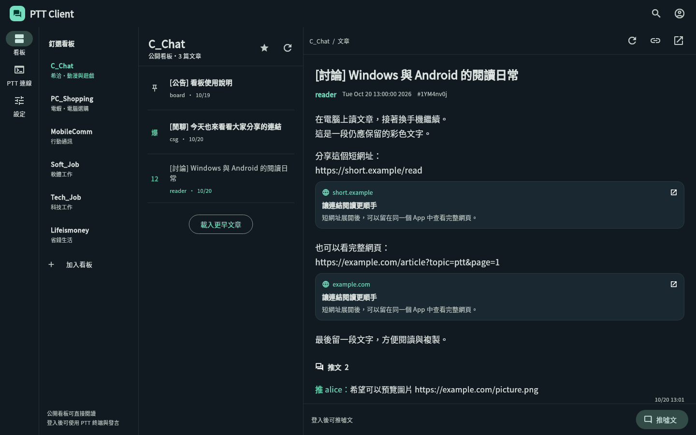
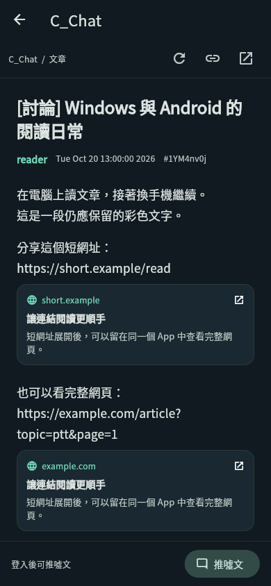

# PTT Client

Windows 與 Android 的 Flutter PTT 客戶端，支援文章閱讀、短網址與連結卡片、App 內網頁預覽，以及 PTT 加密連線。

[](https://github.com/chikenscrach/ptt-client/actions/workflows/build.yml)

目前為 **0.1.0 開發預覽版**。圖形介面先提供公開看板閱讀，登入後透過終端連線執行 PTT 操作。這是獨立第三方專案，非 PTT 官方產品。

## 功能

| 功能 | 目前範圍 |
| --- | --- |
| 看板與文章 | 公開看板、較早文章分頁、本文、推文、文章代碼、重新整理 |
| 釘選與閱讀 | 本機釘選、已讀紀錄、捲動位置、字級與深色模式 |
| 短網址 | 沿 HTTP 轉址找出目的地，顯示最終網域，保留原始網址 |
| 預覽卡片 | Open Graph 標題、摘要與縮圖，缺少資訊時使用網頁標題 |
| 圖片 | 縮圖、放大與縮放，讀取失敗時保留連結 |
| App 內網頁 | Android WebView／Windows WebView2，返回、重整、複製與外部開啟 |
| 預覽設定 | 點擊載入、Wi-Fi／有線網路自動載入、所有網路自動載入 |
| PTT 連線 | WSS、Big5 登入畫面、UTF-8 協商、基本 ANSI 終端與快捷鍵 |
| 登入與發言 | 登入流程、額外提示交由終端處理、依 AID 定位的推噓文流程、本機草稿 |

Windows 寬視窗可並排看板與文章，視窗寬度足夠時在右側顯示網頁預覽。Android 採單頁閱讀。卡片按閱讀位置逐步建立，最多同時下載 3 筆，並使用記憶體快取。

## 介面預覽

以下是以合成測試資料擷取的實際 Flutter 介面，並非正式站帳號或文章。





## 取得測試版

1. 開啟 [Actions → Check and build](https://github.com/chikenscrach/ptt-client/actions/workflows/build.yml)。
2. 選擇最新一次成功的執行紀錄，在 **Artifacts** 下載對應平台。
3. Windows：下載 `ptt-client-windows-x64`，解壓縮後執行 `ptt_client.exe`。保留整個資料夾，包含 DLL 與 `data`。
4. Android：下載 `ptt-client-android-debug`，解壓縮後安裝 `app-debug.apk`。這是以測試金鑰簽署的預覽 APK。

下載 Actions 產物通常需要登入 GitHub；產物保存 14 天，也可以按 **Run workflow** 重新建置。首次建置需下載工具鏈與依賴，請以實際工作流程結果為準。

Windows 需 Windows 10 以上、[WebView2 Runtime](https://developer.microsoft.com/microsoft-edge/webview2/) 與 [Visual C++ Runtime](https://learn.microsoft.com/cpp/windows/latest-supported-vc-redist)。Android 以 Flutter 支援的 Android 7.0／API 24 以上為基準。

## 使用方式

- 從釘選看板開始，或搜尋看板英文名稱，例如 `C_Chat`、`PC_Shopping`。星號可加入／移除本機釘選。
- 預設在 Wi-Fi／有線網路載入卡片，其他網路可按「載入預覽」，或到設定變更。
- 點連結在 App 內開啟完整網頁。Windows 可放大視窗使用右側預覽；選單提供「用外部瀏覽器開啟」。
- 「PTT 連線」提供登入與終端操作。只記住帳號名稱，密碼不寫入檔案。額外驗證、重複登入與站方提示留在終端處理。
- 文章底部的「推噓文」使用已登入的連線。遇到未辨識畫面會停止；最後確認後若結果不明，先查證文章或終端畫面，再決定是否重送。

## 本機開發

專案及 CI 固定使用 **Flutter 3.47.7／Dart 3.13.5**，依賴記錄於 `pubspec.lock`。

```sh
git clone https://github.com/chikenscrach/ptt-client.git
cd ptt-client
flutter pub get --enforce-lockfile
flutter analyze --no-pub
flutter test --no-pub

# Windows 上執行／建置
flutter run -d windows
flutter build windows --release

# Android：先以 flutter devices 找出裝置
flutter run -d DEVICE_ID
flutter build apk --debug
```

Windows 需要 Visual Studio 的 **Desktop development with C++** 工作負載、Flutter Windows 工具鏈及 NuGet CLI。Android 需要 JDK 17、Android SDK，並完成 SDK 授權。Windows 版本請在 Windows 或 Windows CI 建置。

Android 正式發佈需要您持有並保存的簽署金鑰。目前預設簽署僅供測試，不能直接視為商店正式版。

Android 建置固定使用 AGP 8.13.2、Gradle 8.14.3 與 Kotlin 2.3.0，維持與穩定版 WebView 套件及其餘 Android 套件相容。

## 已知限制與驗證狀態

- 看板、文章、編碼、終端、網址轉址、快取、並行下載及響應式介面都有自動測試。測試使用合成資料，不含真實帳密或私人文章。
- 已確認 PTT 的 WSS 端點能成功建立加密握手。開發環境讀取公開網頁收到 HTTP 403，尚未以真實帳號完成登入／發言實測。這不代表您的網路也會被擋；請先在自己的裝置確認完整流程。
- 站方登入頁或提示變動可能影響辨識。遇到陌生提示使用內建終端處理，並先在允許測試的看板驗證發言。
- 釘選、已讀與草稿只在本機保存，目前不與 PTT「我的最愛」或其他裝置同步。私密看板、信箱與完整發文編輯尚無專用圖形介面，可透過終端操作。
- 終端尚未完整支援雙色字與所有私有指令。
- 卡片不執行 JavaScript。JavaScript 跳轉、驗證碼、登入或付費限制可能需要開啟完整網頁或外部瀏覽器。影片目前以封面／網頁預覽為主。
- 本機與私人網路網址不提供預覽。部分網站會阻擋縮圖、爬取或內建瀏覽器，失敗時仍保留原始連結。
- Android 背景期間可能中斷連線。文章位置與草稿會保留，登入與發言不會自動重送。

## 開發文件

- [架構與資料流程](docs/ARCHITECTURE.md)
- [人工驗收項目](docs/TESTING.md)
- [MIT 授權](LICENSE)

連線行為參考 PTT 公開的 [pttbbs](https://github.com/ptt/pttbbs) 協定與操作方式，終端、流程與 Flutter 介面為本專案實作，未將 GPL 終端客戶端程式碼併入。其他套件授權可於 App「設定 → 開源授權」查看。
